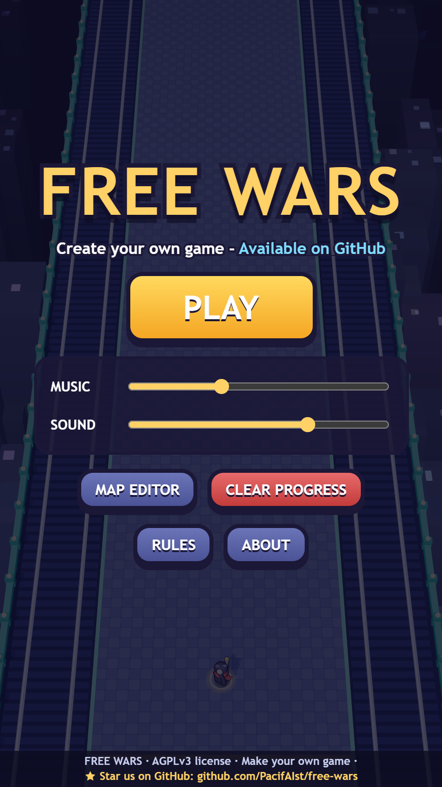
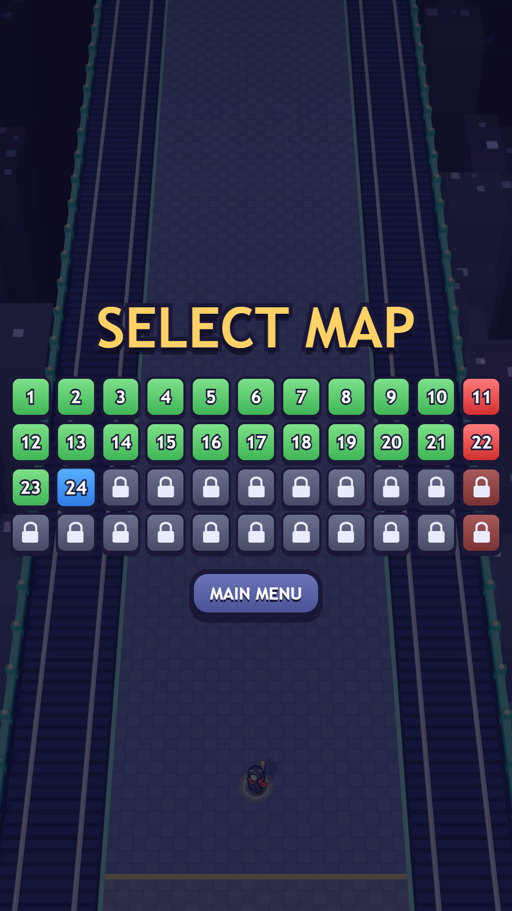
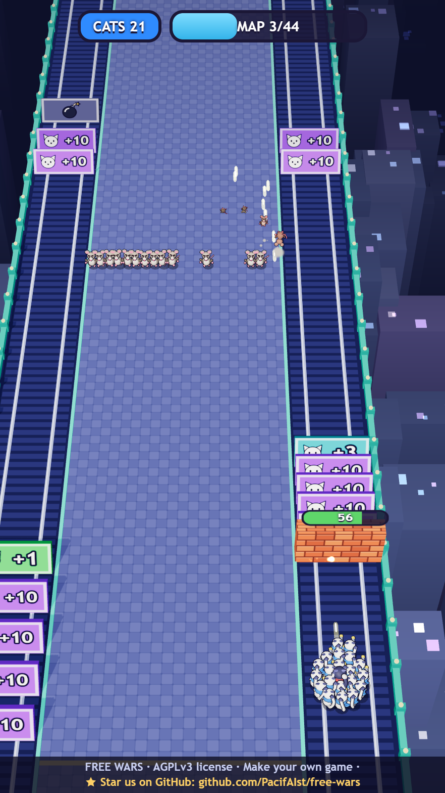
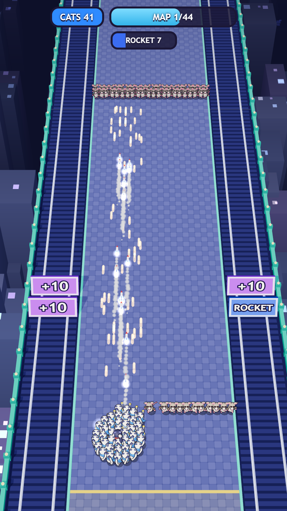
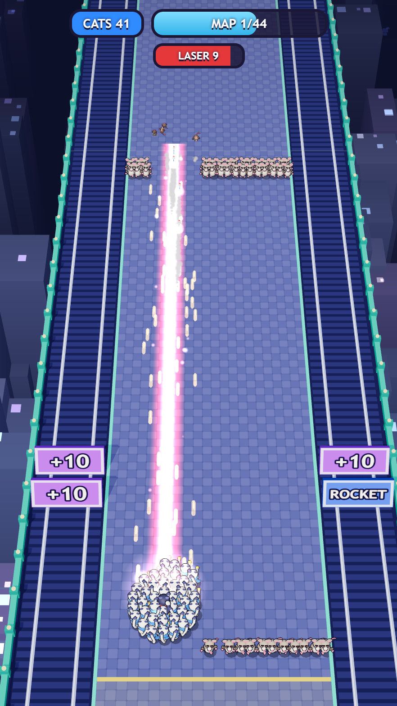
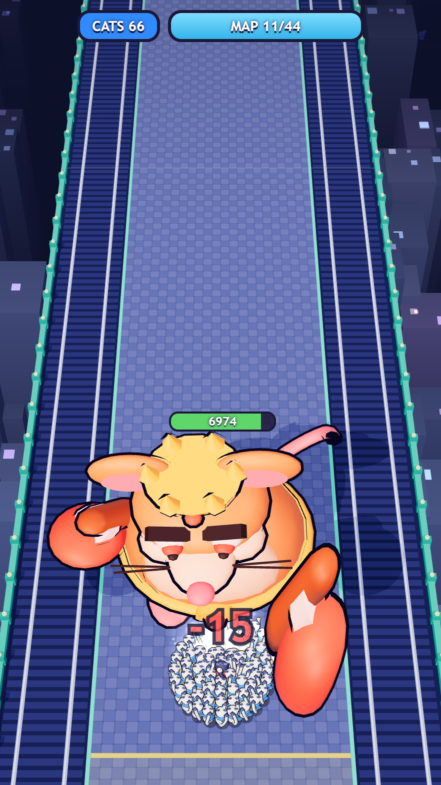
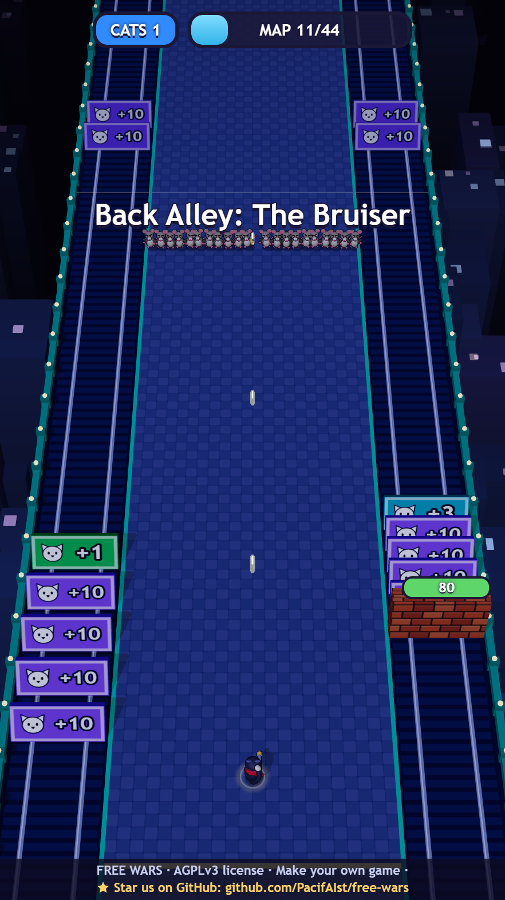
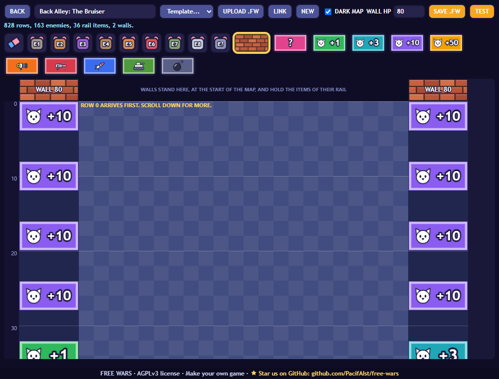

# FREE-WARS

A 3D fixed-shooter crowd game for the browser. A black cat and its clone swarm hold a 44-column lane
against a marching army of rats. Drag to move the swarm; it fires on its own. *Because it is about damn time...*

[PLAY HERE](https://free-wars.pages.dev/)

Status: in development. See `PROGRESS.md` for what is built, `PLAN.md` for the milestone plan,
`SPEC.md` for the original specification and `DESIGN_DECISIONS.md` for every deviation.

## Screenshots

<p align="center">
  
  
  
  
</p>
<p align="center">
  
  
  
</p>
<p align="center">
  
</p>

## Play

- PLAY opens the grid of 44 maps. Map 1 is open; winning a map opens the next. Progress is saved in the browser.
- Drag left or right: the swarm follows your finger and fires on its own. You start with one black cat.
- Powerups ride the rails on both sides of the lane. Step onto a rail and let a panel reach you: more cats (+1, +3, +10, +50) or a weapon (minigun, laser, rocket, tank).
- Fat rats drop a box when they die; catch it. A tank comes in a bubble: shoot it open.
- Rats march straight for the goal. Going to a rail leaves the lane open, so choose.
- A rat that touches a cat kills it. A big rat punches: get out of its reach or bring it down first. Lose every cat and the level is lost.
- The gold line at the bottom is the goal: the first rat to cross it loses the level.
- Desktop: arrow keys or A/D also move the swarm; P or Escape pauses; Enter or Space presses the main button; M mutes.
- Add `?map=0` to the address to open the dev map (a stress test, not a balanced level).

## Music

`music/0.mp3` plays on the menus. A map plays the track of its last digit (`music/4.mp3` for maps
4, 14, 24 and 34), maps ending in 0 play `10.mp3`, and the boss maps 11, 22, 33 and 44 play
`11.mp3`. The tracks are from Pixabay and Unminus.

## Map editor

MAP EDITOR on the splash screen. Drag an enemy or an item from the palette onto the grid, or pick
it and press on the grid; drag on to paint minions and rail items; the rubber erases. Whatever
you place replaces what it covers. Scroll down for more rows: row 0 reaches the swarm first.

- **Brick wall:** drop it on a rail. It goes in the strip above the grid, because a wall stands
  at the start of the map; it holds the items of that rail until it is shot down. WALL HP sets
  how many shots it takes.
- **DARK MAP** makes it a night map.
- **Template** loads one of the 44 maps to start from.
- **SAVE .FW** downloads the map as a text file. **UPLOAD .FW** reads one back, in your browser
  only. **LINK** reads one from a web address. A file that is not a map gives "Wrong file".
- **TEST** plays the map.
- Add `?fw=<link to a .fw file>` to the game's address to play that map directly.
- To replace built-in map 7, save your map as `public/maps/7.fw`.

A `.fw` file is plain text, one thing per line, `row,column,what`:

```
FREE-WARS MAP 1
name: My map
0,L,+10
0,R,ROCKET
0,L,WALL hp=150
dark: yes
112,0,E1
230,14,E4 hp=320 drop=+50
```

Column 0-43 is the left cell of a unit in the lane; `L` and `R` are the rails. In the lane:
`E1`-`E8` or `ER` (a random minion). On a rail: `? +1 +3 +10 +50 MINIGUN LASER ROCKET TANK BOMB`.

## Changing the numbers

Every speed, HP, damage, size and timing is in one file: `src/game/constants.ts`. Save it and
the page reloads. The ones you will want most:

| What | Constant |
|---|---|
| Speed of all enemies | `SPEED_SCALE` |
| HP, size and speed of each enemy | `ENEMY_STATS`, `BIG_HP_FACTOR` |
| Cats killed by a punch, and its pace | `PUNCH_KILLS`, `SMASH_INTERVAL` |
| Enemy rockets | `ENEMY_ROCKETS` |
| Fire rate, bullet speed and damage | `FIRE_RATE`, `CLONE_FIRE_RATE_FACTOR`, `BULLET_SPEED`, `BULLET_DAMAGE` |
| Weapons | `MINIGUN_*`, `LASER_*`, `ROCKET_*`, `TANK_*` |
| Bomb | `BOMB_KILLS`, `BOMB_HITS_CATS` |
| Brick wall | `WALL_Y`, `WALL_DEFAULT_HP` |
| How far a drag moves the swarm | `DRAG_SENSITIVITY` |
| Speed of panels and boxes | `RAIL_ITEM_SPEED_SPEC`, `POWERUP_SPEED` |
| Clones at the start, clone cap | `START_CLONES`, `CLONE_CAP` |
| Camera | `CAMERA_*`, `VIEW_COLS` |
| Volumes | `SFX_VOLUME`, `MUSIC_VOLUME_RATIO` |

## Develop

```
npm ci
npm run dev          # Vite dev server
npm test             # Vitest
npm run check        # typecheck, lint, tests and both builds
```

## Build

```
npm run build          # dist/         static files for any host, subfolder or WebView
npm run build:single   # dist-single/  one index.html that opens by double-click
```

## Art

The game is drawn in 3D with three.js. Every model is built from code in `src/render/models.ts`,
and every sound effect is synthesised in `src/game/Audio.ts`; there are no model or texture files. `npm run gen:sprites` draws the 2D user-interface sheet
(icons, portraits, favicon) into `art/ui/`.

## Licence

AGPL-3.0. See `LICENSE`.
